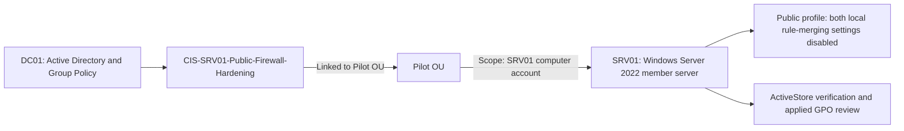
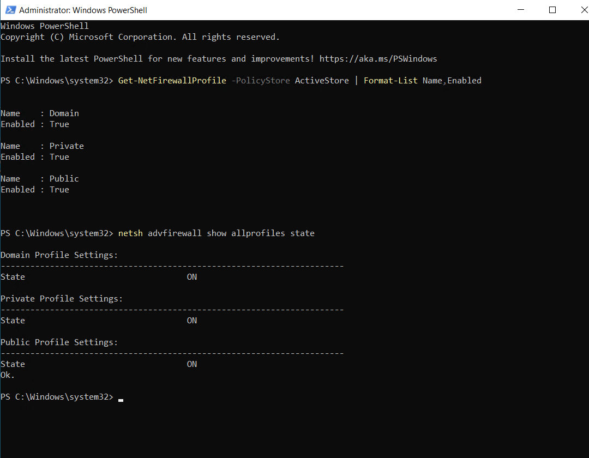
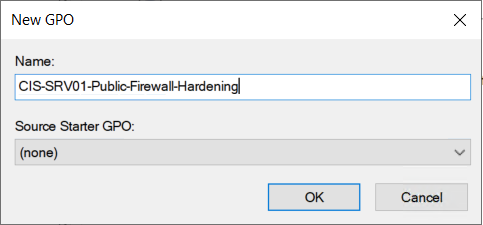
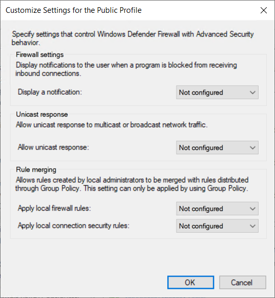
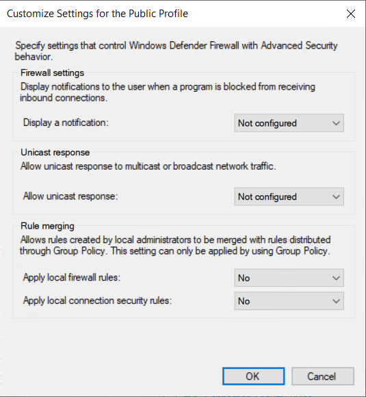
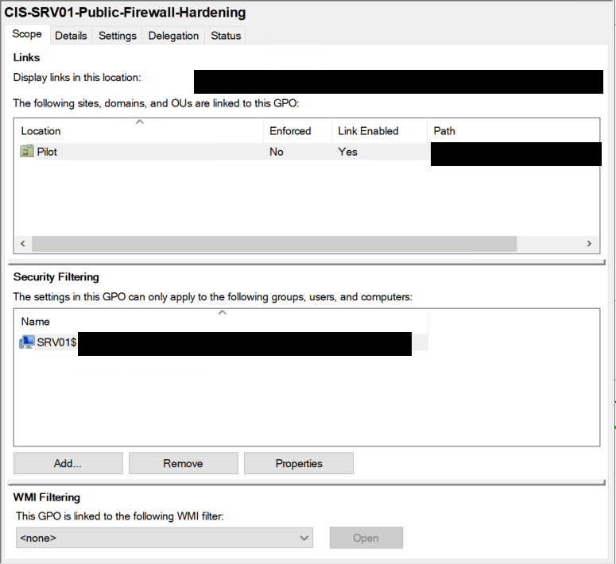

# CIS Windows Server 2022 Firewall Assessment & Group Policy Hardening

**Windows Server 2022 · Active Directory · Group Policy · PowerShell · Configuration assessment**

## Overview

This lab assessed **five selected firewall checks** from the **CIS Microsoft Windows Server 2022 Benchmark v5.1.0, Level 1 Member Server**, on **SRV01**, a Windows Server 2022 member server managed through **DC01**, Active Directory, and Group Policy.

Two Public profile rule-merging settings failed the initial review. A targeted Group Policy change disabled both settings, and independent effective-configuration checks verified the resulting state and applied GPO. Both findings are **remediated at the effective-configuration level**.

These are selected configuration validations, **not official CIS-CAT results**, a full benchmark assessment, or a compliance certification. Results reflect the author's supplied observations; repository authoring did not rerun the lab checks.

## Business scenario

A team needs to prevent local Public profile firewall and connection security rules from merging with centrally managed policy on a member server. The change must be narrowly scoped to the pilot computer, preserve Domain and Private profile settings, and be verified independently of the policy editor.

## Architecture



This logical diagram does not establish a broader network topology. Ethernet was **DomainAuthenticated** during the pre-deployment review; Public profile configuration was assessed without claiming a Public-network traffic test.

## Methodology and change validation

1. Review five selected firewall checks on SRV01 and record effective configuration.
2. Before deployment, inspect locally enabled inbound rules and confirm Ethernet's network category was DomainAuthenticated. The detailed rule inventory is retained privately; no traffic-impact test result was supplied.
3. Create `CIS-SRV01-Public-Firewall-Hardening`, link it to **Pilot OU**, and scope it to the **SRV01 computer account**.
4. Configure the Public profile's **Apply local firewall rules** and **Apply local connection security rules** options to **No**. Preserve Domain and Private profile settings.
5. Independently verify effective settings and the applied computer GPO list using the commands below. No specific policy refresh command or deployment timestamp was supplied.

```powershell
Get-NetFirewallProfile -PolicyStore ActiveStore |
    Select-Object Name, Enabled, AllowLocalFirewallRules, AllowLocalIPsecRules

gpresult /r /scope computer
```

The final Public profile was **Enabled True**, **AllowLocalFirewallRules False**, and **AllowLocalIPsecRules False**. The applied GPO list included **CIS-SRV01-Public-Firewall-Hardening**. This verifies effective settings and GPO application; it does not establish packet filtering behavior under a Public network category or the removal of local rule definitions.

## Evidence walkthrough

The images below are actual source captures, cropped or redacted on copies to remove unrelated infrastructure details. Text blocks reproduce selected source exports; the gpresult block is explicitly a sanitized excerpt. No endpoint checks were rerun during publication.

### 1. Baseline and pre-change review

`Get-NetFirewallProfile -PolicyStore ActiveStore` established effective profile state. The screenshot also shows a corroborating read-only netsh state query.

*Domain, Private, and Public firewall profiles enabled before the change*



**Recorded evidence — [03_CIS_Firewall_Policy_Assessment.txt](evidence/03_CIS_Firewall_Policy_Assessment.txt):**

```text
Name                    : Domain
DefaultInboundAction    : Block
DefaultOutboundAction   : Allow
AllowLocalFirewallRules : True
AllowLocalIPsecRules    : True

Name                    : Private
DefaultInboundAction    : Block
DefaultOutboundAction   : Allow
AllowLocalFirewallRules : True
AllowLocalIPsecRules    : True

Name                    : Public
DefaultInboundAction    : Block
DefaultOutboundAction   : Allow
AllowLocalFirewallRules : True
AllowLocalIPsecRules    : True
```

Enabled local inbound rules were reviewed privately; the detailed rule inventory is not published. The network profile evidence confirms the observed Ethernet category, not a Public-network traffic test.

**Recorded evidence — [08_CIS_Active_Network_Profile.txt](evidence/08_CIS_Active_Network_Profile.txt):**

```text
InterfaceAlias     NetworkCategory IPv4Connectivity
--------------     --------------- ----------------
Ethernet       DomainAuthenticated         Internet
```

### 2. Dedicated GPO and Public rule-merging settings

*New GPO name entered in Group Policy Management*



*GPO editor before configuration: both Public rule-merging options Not configured*



The editor's Not configured values are not the endpoint's effective before-state. The separate baseline export above reports both effective values as True.

*Public Apply local firewall rules and Apply local connection security rules set to No*



### 3. Pilot link and SRV01 scope

*GPO linked to Pilot OU with SRV01 computer security filtering; domain details redacted*



This capture shows the link and filtering configuration. The applied-GPO excerpt below independently supports application to the target.

### 4. Effective configuration and applied GPO validation

The source exports record results of `Get-NetFirewallProfile -PolicyStore ActiveStore` and `gpresult /r /scope computer`. No screenshot of the final PowerShell output was supplied; the actual reviewed text is displayed instead.

**Recorded evidence — [09_CIS_Firewall_Remediation_Validation.txt](evidence/09_CIS_Firewall_Remediation_Validation.txt):**

```text
Name                    : Public
Enabled                 : True
AllowLocalFirewallRules : False
AllowLocalIPsecRules    : False
```

**Recorded evidence — [10_CIS_GPO_Application_Verification_Excerpt.txt](evidence/10_CIS_GPO_Application_Verification_Excerpt.txt):**

```text
Sanitized excerpt from 10_CIS_GPO_Application_Verification.txt
Only the relevant applied GPO entry is retained; domain and unrelated details omitted.

Applied Group Policy Objects
----------------------------
    CIS-SRV01-Public-Firewall-Hardening
```

Both findings remain remediated **at effective-configuration level**. This evidence does not establish Public-profile traffic testing or resolution of the unrelated Process Creation auditing issue.

## Before and after

| Selected CIS check | Effective property / target | Before | Initial result | After | Final result |
| --- | --- | --- | --- | --- | --- |
| 9.1.1 Domain Firewall Enabled | Domain Enabled = True | True | Pass | True | Pass |
| 9.2.1 Private Firewall Enabled | Private Enabled = True | True | Pass | True | Pass |
| 9.3.1 Public Firewall Enabled | Public Enabled = True | True | Pass | True | Pass |
| 9.3.4 Public Apply local firewall rules | Public AllowLocalFirewallRules = False | True | Fail | False | Pass |
| 9.3.5 Public Apply local connection security rules | Public AllowLocalIPsecRules = False | True | Fail | False | Pass |

The Domain and Private profile settings were preserved. The table represents **only these five selected effective-configuration checks**, not an overall CIS score.

## Findings

| Finding | Initial observation | Recorded remediation | Status |
| --- | --- | --- | --- |
| CIS-FW-01 | Public AllowLocalFirewallRules True | Targeted GPO set local firewall rule merging to No; effective value False | Remediated — effective configuration |
| CIS-FW-02 | Public AllowLocalIPsecRules True | Targeted GPO set local connection security rule merging to No; effective value False | Remediated — effective configuration |

See [finding records](docs/FINDINGS.md) and the [assessment report](docs/ASSESSMENT_REPORT.md). No exploit, unauthorized rule, or security incident is asserted.

## Read-only baseline script

[scripts/check-firewall-baseline.ps1](scripts/check-firewall-baseline.ps1) reads ActiveStore, evaluates the five selected targets, and saves a timestamped JSON report. It does not change firewall settings, rules, services, network categories, GPOs, or policy refresh state.

Run on the intended server in Windows PowerShell 5.1 with permission to read firewall state and write to the chosen existing output directory:

```powershell
.\scripts\check-firewall-baseline.ps1 -OutputDirectory $env:TEMP
```

The report includes collection time and selected settings, not host/domain identifiers or raw `gpresult` output. The script writes a local report file; it makes no policy changes or network requests. Errors stop collection rather than fabricating Pass/Fail results. A returned value other than explicit True or False is **Review required**, not a pass. Do not run it with an output directory you cannot write to, and inspect output before publication.

**Repository validation:** Windows PowerShell 5.1 syntax parsing passed for the script, both PowerShell examples parsed successfully, and 38 relative Markdown links and anchors passed validation. These are authoring checks, not endpoint security test results. Execution of this newly authored script on SRV01 is not claimed, and no generated report is included as lab evidence.

## Evidence and documentation

| Resource | Purpose |
| --- | --- |
| [Assessment report](docs/ASSESSMENT_REPORT.md) | Scope, observations, change, validation, and residual limitations |
| [Findings](docs/FINDINGS.md) | CIS-FW-01 and CIS-FW-02 evidence and closure basis |
| [Evidence index](docs/EVIDENCE_INDEX.md) | Original filenames, public copies, and sanitization details |
| [Evidence instructions](evidence/README.md) | Sanitization and later screenshot publication |

Five sanitized screenshots and four reviewed text artifacts are now published and displayed in the evidence walkthrough. The index maps them to their original filenames. No generated output, proprietary benchmark PDF, raw rule inventory, or unsanitized gpresult report is published.

## Lessons learned and scope limitations

- Verify effective settings and applied GPOs separately; the editor alone does not demonstrate application.
- Narrow pilot targeting supports controlled deployment. This lab does not establish behavior on other servers.
- Reviewing enabled inbound rules helps identify dependencies, but does not replace traffic testing.
- A DomainAuthenticated interface can coexist with validated Public profile configuration; this does not prove Public-profile traffic enforcement was exercised.
- Disabling rule merging does not establish that local rules were deleted or that every security requirement is satisfied.
- Only five firewall checks were reviewed. No CIS-CAT scan, full benchmark score, broader compliance claim, or unperformed remediation is included.
- A previous **Process Creation auditing troubleshooting issue remains unresolved** and outside this firewall scope. Nothing here establishes its remediation.

## Author

**Musah Issah** · Cybersecurity · Information Assurance · Governance, Risk & Compliance

[GitHub](https://github.com/MusahIssah)

*Controlled lab documentation. The proprietary full CIS Benchmark PDF and security-sensitive raw evidence are not published.*
